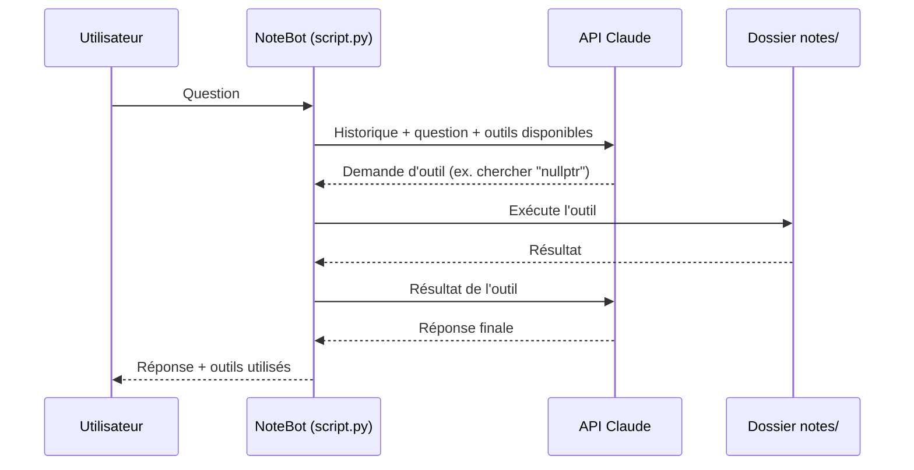

# NoteBot

**Un assistant de révision propulsé par Claude qui répond à tes questions à partir de tes propres notes de cours.**

NoteBot est un agent IA en ligne de commande. Au lieu de répondre de mémoire, il **consulte d'abord tes fichiers de notes** : il les liste, y cherche des mots-clés et les lit, puis construit sa réponse en indiquant le fichier sur lequel il s'appuie. Il garde le fil de la conversation, ce qui permet d'enchaîner les questions comme avec un tuteur.
---

## Aperçu

```text
NoteBot prêt ! Pose ta question ('reset' pour recommencer, 'quitter' pour sortir).

Toi : Où est-ce que je parle de nullptr dans mes notes ?
  [outil] chercher({'texte': 'nullptr'})

NoteBot : Tu en parles dans pointeurs.txt (lignes 12 et 27). Tu y notes qu'après
un delete, on remet le pointeur à nullptr pour éviter un double delete...

Toi : Fais-moi un quiz de 3 questions là-dessus
  [outil] lire_fichier({'nom': 'pointeurs.txt'})

NoteBot : Question 1 : ...
```

## Fonctionnalités

- **Réponses fondées sur tes notes** : l'agent consulte tes fichiers avant de répondre et cite sa source.
- **Trois outils** que le modèle choisit lui-même d'utiliser :
  - `lister_fichiers` : liste les notes disponibles ;
  - `lire_fichier` : lit le contenu d'un fichier ;
  - `chercher` : trouve un mot ou une expression dans toutes les notes, avec le fichier et le numéro de ligne.
- **Conversation continue** : le bot se souvient des questions précédentes. La commande `reset` repart de zéro.
- **Coûts maîtrisés** : l'historique est limité aux 20 dernières questions, et le nombre d'étapes par réponse est plafonné.
- **Robuste** : si un appel à l'API échoue, l'échange raté est annulé proprement et la conversation reste utilisable.
- **Sécuritaire** : l'agent n'a accès qu'au dossier `notes/`, en lecture seule. Les chemins comme `../` sont refusés.
- Formats acceptés : `.txt` et `.md`.

## Fonctionnement

NoteBot repose sur la boucle d'agent de l'API Claude (*tool use*) : le modèle décide quels outils appeler, le programme les exécute localement, puis lui renvoie les résultats jusqu'à obtenir une réponse finale.



## Installation

**Prérequis :** Python 3.10 ou plus récent, et une clé API Anthropic ([console Claude](https://platform.claude.com/settings/keys)).

```bash
git clone https://github.com/Emmanuelkss/notebot.git
cd notebot
python -m venv .venv
```

Active l'environnement virtuel :

```bash
# Windows (PowerShell)
.venv\Scripts\Activate.ps1

# macOS / Linux
source .venv/bin/activate
```

Installe la dépendance :

```bash
pip install anthropic
```

## Configuration

La clé API se donne **par variable d'environnement**, jamais dans le code.

```bash
# Windows (PowerShell)
$env:ANTHROPIC_API_KEY="sk-ant-..."

# macOS / Linux
export ANTHROPIC_API_KEY="sk-ant-..."
```

Variables optionnelles :

| Variable | Rôle | Valeur par défaut |
|---|---|---|
| `NOTEBOT_MODELE` | Modèle Claude utilisé | `claude-sonnet-5-5` |
| `NOTEBOT_NOTES` | Dossier contenant les notes | `notes/` à côté du script |

Pour réduire les coûts, utilise `NOTEBOT_MODELE=claude-haiku-5-5`.

## Utilisation

1. Place tes notes (`.txt` ou `.md`) dans le dossier `notes/`. Il est créé automatiquement au premier lancement.
2. Lance NoteBot :

```bash
python script.py
```

| Commande | Effet |
|---|---|
| *(ta question)* | NoteBot consulte tes notes et répond |
| `reset` | Efface la conversation et recommence |
| `quitter`, `exit` ou `q` | Ferme NoteBot |

## Structure du projet

```text
notebot/
├── script.py     # Agent : outils, boucle d'agent, conversation et interface console
├── notes/        # Tes fichiers de notes (.txt, .md), non versionnés
└── README.md
```

## Feuille de route

- [ ] API web (Flask) avec sessions, mot de passe et limite de requêtes
- [ ] Interface web de chat
- [ ] Prise en charge des notes en PDF
- [ ] Génération de quiz et de fiches de révision
- [ ] Déploiement en ligne

## Technologies

- **Python**
- **[API Claude d'Anthropic](https://platform.claude.com/docs)** : modèles Claude et utilisation d'outils (*tool use*)

## Auteur

**Emmanuel** — [@Emmanuelkss](https://github.com/Emmanuelkss)
